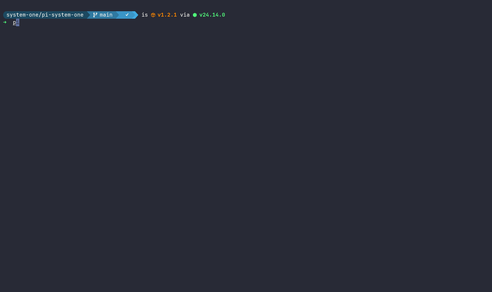

# pi-system-one

Vendored from [`iamaamir/system-one`](https://github.com/iamaamir/system-one/tree/main/pi-system-one) at revision `17be72d3595532a79ff68070dd69720a7631e108`. Upstream package and `system-one-core` declare MIT licensing.

A System One decision model can be declared independently of Pi's chat model registry in `pi-system-one.json`. Its configured endpoint must implement the System One HTTP protocol at `POST /v1/systemone`; the API key is read from `apiKeyFile` on each decision and is never stored in settings or diagnostics.

System One decisions for Pi. Without a declared decision model, the HTTP route follows your active Pi chat model's endpoint and credentials. You can also select TypeSafe, Reflex, or another System One-compatible provider.

```bash
pi install npm:pi-system-one
```

## Pi built-in classifier vs `pi-system-one` (as of Pi v1.0.3)

Pi already supports Jev through `codemode`. It can classify one question or combine classification with other tool calls in a script. This extension exposes decisions as a dedicated `system_one` tool, with a `/judge` prompt and a skill that guides when to use it. Choose based on your workflow, not on a claim that either route is more accurate.

| Need | Pi classifier through `codemode` | `pi-system-one` today |
|---|---|---|
| Setup | Enable `codemode`; sign in to the provider used by your selected classifier. | Install extension. HTTP mode uses a declared decision provider when configured, otherwise the active Pi chat model's endpoint and credentials. |
| Agent interface | Script calls `models.classify()`; you choose model, state, and questions. | Model calls `system_one` directly. `/judge` and bundled skill provide usage guidance. |
| One-off decisions | Write a `codemode` script even for a standalone classification. Useful if you already use scripts. | Call `system_one` without writing a script or enabling `codemode`. The same tool works mid-conversation when no other tool calls need orchestration. |
| Multiple tool calls | A script can gather data, call a classifier, and filter results before they reach the model. | The tool batches decision questions over supplied state, but does not replace `codemode` for scripting other tools. |
| Host availability | Requires a Pi host with `codemode` enabled and classifier models exposed to its scripts. | Loads as an extension without `codemode`; package also declares an OMP extension entry. Requires a host that supports this extension's APIs. |
| Endpoints | Pi's registered classifier models, including Jev across supported providers. | A declared provider targets a System One protocol backend at `POST /v1/systemone`; other modes can use TypeSafe, local Reflex, or custom endpoints. |
| Inputs | Pi classifier schema: object state, string question fields, `bool` for yes/no. | Accepts string or JSON state, `noul` for yes/no, and normalizes common argument aliases. |
| Score output | Score and confidence. Choice answers still include probabilities. | Score, confidence, per-level probabilities, and legend when backend supplies them. |
| Credentials | Pi resolves provider credentials, including saved provider logins. | A declared decision provider reads its configured API key file per call and sends it only to its configured endpoint. Otherwise, default HTTP mode resolves the active model's Pi credentials and headers per call. Explicit environment/session keys are limited to their configured endpoint; custom endpoints never inherit active-model credentials. |

Pi's [v1.0.3 Codemode guide](https://github.com/earendil-works/pi/blob/v1.0.3/packages/coding-agent/docs/codemode.md) documents scripts, model calls, and orchestration. Its [CLI guide](https://github.com/earendil-works/pi/blob/v1.0.3/packages/coding-agent/docs/cli.md#enable-codemode) explains how to enable `codemode`. Pi extensions can also [call classifiers without Codemode](https://github.com/earendil-works/pi/blob/v1.0.3/packages/coding-agent/docs/models.md#use-classifier-models); the table compares the agent-facing Codemode route with this extension's agent-facing tool, not every way to write a Pi extension.

Pi v1.0.3 [defines its Score answer](https://github.com/earendil-works/pi/blob/v1.0.3/packages/ai/src/types.ts#L660-L678) with only `score` and `confidence`. Its [response parser](https://github.com/earendil-works/pi/blob/v1.0.3/packages/ai/src/api/system-one-shared.ts#L80-L119) copies only those two Score fields. [TypeSafe's HTTP API](https://docs.typesafe.ai/api#score-answer) returns `probabilities` and `legend` too. Pi's [classifier input types](https://github.com/earendil-works/pi/blob/v1.0.3/packages/ai/src/types.ts#L635-L658) and [codemode docs](https://github.com/earendil-works/pi/blob/v1.0.3/packages/coding-agent/docs/codemode.md#classify) document the narrower inputs shown above. These references describe Pi v1.0.3, not future releases.

If you already use `codemode` to combine tools and only need Pi's classifier response, use Pi's built-in route. For standalone decisions, choose this extension when you want a direct tool without a script or Codemode setup. It also provides prompt guidance, compatible custom endpoints, and the full Score distribution when the backend supplies it. The extension can run on a host without `codemode` if that host supports its extension APIs. Its OMP package entry makes it installable in OMP, but it does not guarantee support for every Pi or OMP version. `/so config` can save non-secret settings or select Pi's native classifier. Native mode rejects Score questions because Pi v1.0.3 does not expose their probability distribution. Optional `auto` mode routes native-compatible Choice/Noul requests to Pi's classifier when registered and other requests to active-model HTTP; it does not retry a failed call through another backend. See [Pi classifier docs for v1.0.3](https://github.com/earendil-works/pi/blob/v1.0.3/packages/coding-agent/docs/models.md#use-classifier-models).

For Oh My Pi (OMP), install the published package with:

```bash
omp install npm:pi-system-one
```

For a local checkout, install or load the package directory directly:

```bash
omp install /path/to/pi-system-one
# or
omp --extension /path/to/pi-system-one
```

The `system_one` tool and automatic operation-advice hooks register at startup. Before selected higher-risk shell commands, unusual file reads, and file edits/writes, the extension sends a minimized, redacted judgment request through the configured System One provider. Results are attached to the operation result as advice only; they do not block or authorize execution. Routine shell commands and normal in-workspace reads are skipped. Evaluations are capped per turn and time-limited; provider failures produce no advice and do not change operation behavior. Subagent Pi processes load the same configured extension and therefore use the same hooks.

Without a declared decision provider, HTTP requests use the active Pi chat model's base URL, model ID, and request-time credentials. A declared provider instead supplies System One's independent endpoint, model ID, and request-time key file. The configured service must implement `POST /v1/systemone` (it is a System One protocol endpoint, not just any OpenAI-compatible chat completion API).

<!--     -->

---


### Custom endpoint

For Reflex or another backend that supports `POST /v1/systemone`, run `/so config` and choose `custom`, or retain your existing environment setup:

```bash
export SYSTEM_ONE_BASE_URL=http://localhost:8008
export SYSTEM_ONE_MODEL=reflex
# Set SYSTEM_ONE_API_KEY only when your endpoint requires a key.
```

`SYSTEM_ONE_BASE_URL` selects a custom endpoint when no mode is saved. A saved mode and custom endpoint win on restart. Model mode sends the active Pi model ID unless `SYSTEM_ONE_MODEL` overrides it; custom endpoints may require their own `SYSTEM_ONE_MODEL`.


---

## Configuration

Run `/so` or `/so config` to select `model` (declared decision provider when configured, otherwise active chat model), `typesafe` (fixed TypeSafe endpoint), `custom` (a configured System One endpoint), `native` (Pi classifier), or `auto` (per-request routing). `/so config model`, `/so config auto`, `/so config native`, and `/so config typesafe` switch directly. Non-secret settings are saved to `<agent-dir>/pi-system-one.json`, where `<agent-dir>` is Pi's agent directory (`~/.pi/agent` by default or `PI_CODING_AGENT_DIR`). Terminal Pi and Paseo must use the same agent directory to share that file and Pi's saved login. Restart or reload an already-running client after the other client changes settings. Use `/so status` to inspect current mode and credential availability.

For example, an explicit decision model declaration can coexist with the persisted mode and timeout settings:

```json
{
  "mode": "model",
  "default": { "provider": "litellm", "model": "openrouter/jev-1.14" },
  "providers": {
    "litellm": {
      "baseUrl": "https://litellm.example/v1",
      "apiKeyFile": "~/.config/sops-nix/secrets/litellm-pi-api-key",
      "models": [{ "id": "openrouter/jev-1.14" }]
    }
  }
}
```

The default must reference a declared provider model. `baseUrl` must be HTTP(S), with no URL credentials, query, or fragment. `apiKeyFile` is a path (supports `~` expansion), not a secret value. `/so config` preserves this provider/default declaration when saving mode settings.

For example, a saved custom endpoint looks like this:

```json
{
  "mode": "custom",
  "baseUrl": "http://localhost:8008",
  "model": "reflex",
  "timeoutMs": 10000
}
```

Never store a key in JSON. A key entered into `/so config` stays in this session only. Leave key input blank to keep it; enter `-` to forget it. For custom endpoints, set `SYSTEM_ONE_BASE_URL` with `SYSTEM_ONE_API_KEY` if using environment credentials. An environment key without an environment endpoint never follows a saved custom URL. Custom URLs saved by `/so config` must be HTTP(S), without URL credentials, query, or fragment; put authentication in the key input or environment instead. Native mode supports Choice and Noul but rejects Score questions rather than hide missing probabilities. For full Score results, select `model`, `typesafe`, `custom`, or `auto`. Auto uses native only when the complete request is compatible and Pi has a registered classifier. Otherwise, it uses active-model HTTP, not a custom endpoint. A failed native call does not trigger an HTTP retry. Registered models may still fail without valid credentials.

Use `/so debug` to inspect up to 20 recent `system_one` calls in a terminal overlay. It shows selected provider (`pi-native`, `typesafe`, or `configured`), route reason, sanitized HTTP POST target, outcome, timing, and question-type counts. Failed calls distinguish provider selection from an attempted request, and show fixed native failure categories (unsupported Score, classifier exception/error, invalid response, or abort) without provider-controlled error text. Diagnostics stay in memory for the current Pi session; they never store request state, criteria, credentials, raw URLs, or raw provider error text. Target display retains origin and common API path segments but redacts URL userinfo, queries, fragments, and other path segments. In RPC mode, `/so debug` sends a brief notification instead; JSON and print modes have no UI. `/so status` remains focused on settings.

A current-session selection takes effect immediately. Saved mode and saved custom endpoint win on restart. `SYSTEM_ONE_BASE_URL` selects a custom endpoint only when no mode is saved; without either a custom endpoint or declared decision provider, HTTP mode follows the active Pi chat model. `SYSTEM_ONE_API_KEY` and `SYSTEM_ONE_MODEL` are used only with their matching endpoint; model mode uses the declared decision provider/model when present, otherwise the active model's resolved auth, headers, base URL, and ID. `SYSTEM_ONE_TIMEOUT_MS` can override a saved timeout. `/so status` shows the mode source and notes when a saved choice ignores an environment endpoint. To return to environment-only routing, remove the saved non-secret settings file. When `/so config` changes a custom URL, blank model input clears the old endpoint's model; enter a replacement when needed.

---

## `/judge`

The automatic operation advisor runs at tool lifecycle hooks; it does not require a manual `/judge` invocation. It checks risky shell command proposals, non-routine file reads, and proposed file mutations, then appends a short advisory to the corresponding result when concern is elevated. This is advisory, not a security boundary: Pi permissions and OS-level isolation remain authoritative. Payloads are capped and common secret patterns are redacted; avoid routing sensitive task content to an untrusted decision endpoint.

The fastest way to use System One manually. A prompt shortcut that expands into
instructions calling the `system_one` tool explicitly, so routing
doesn't depend on inferring intent. For short, unstructured asks:

```
/judge should I ship this? <paste diff plus test summary>
```

```
/judge which team should take this ticket? <paste ticket>
```

---

## `system_one` skill

For everything else, the bundled skill teaches the agent when to call
`system_one`, which question type to use (`choice` / `noul` / `score`),
and how to read answers. It loads automatically — just ask for
quantified answers over material already in context. Probabilities and
confidence are the words that route to the tool. Retrieve facts first;
the judge weighs supplied state, it cannot recall facts.

See [SKILL.md](./skills/system-one/SKILL.md) for the full reference
and [use cases](./skills/system-one/references/use-cases.md) for
copy-pasteable recipes.

Examples — same decisions, quantified wording:

```
Pick one: fix forward with a minimal patch, or revert and re-land
later. Give me the probability of each and your confidence.
<paste context>
```

```
This just landed in our support queue — which team is the most likely
owner: billing, technical, or sales? Give me the probability for each
and your confidence for the pick. Also, how urgent is it on a low /
medium / critical scale? And should I escalate (yes/no probability,
no confidence needed)?
<paste ticket>
```

```
Should I ship this or revert it? Give me the probability that shipping
causes a follow-up bug within a week (yes/no probability only — noul
has no confidence field). Also rate the test coverage — none, partial,
or full — with probabilities and confidence for the pick.
<paste diff plus test summary>
```

Independent judgments over the same context should be batched into one
call, and answers should come back as calibrated, state-conditional
probabilities — with confidence for choice/score only (noul has no
confidence) — not prose guesses, and never as recalled facts.

Running your own backend? See the [system one core package](../system-one-core/README.md)
